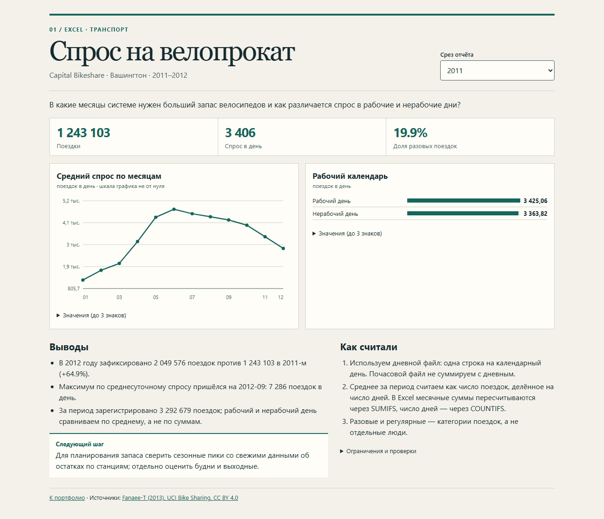

# Спрос на велопрокат

Capital Bikeshare · Вашингтон · 2011–2012

В какие месяцы системе нужен больший запас велосипедов и как различается спрос в рабочие и нерабочие дни?

[Открыть отчёт](dashboard.html) · [Витрина CSV](summary.csv)



## Выводы

- В 2012 году зафиксировано 2 049 576 поездок против 1 243 103 в 2011-м (+64.9%).
- Максимум по среднесуточному спросу пришёлся на 2012-09: 7 286 поездок в день.
- За период зарегистрировано 3 292 679 поездок; рабочий и нерабочий день сравниваем по среднему, а не по суммам.

**Следующий шаг:** Для планирования запаса сверить сезонные пики со свежими данными об остатках по станциям; отдельно оценить будни и выходные.

## Методика

- Используем дневной файл: одна строка на календарный день. Почасовой файл не суммируем с дневным.
- Среднее за период считаем как число поездок, делённое на число дней. В Excel месячные суммы пересчитываются через SUMIFS, число дней — через COUNTIFS.
- Разовые и регулярные — категории поездок, а не отдельные люди.

## Ограничения

- Данные за 2011–2012 годы описывают исторический спрос и не показывают, сколько поездок потеряно из-за нехватки велосипедов.
- Сравнение месяцев не выделяет эффект погоды, роста сети или состава пользователей.

## Контроль качества

- 731 уникальный день без календарных разрывов
- Разовые + регулярные = всего для каждого дня
- Годовые суммы совпадают с месячной и календарной разбивками

## Воспроизводимость

- `analyze.py` — загрузка источника, расчёт и сверки.
- `summary.csv` — агрегаты рассчитанных срезов.
- `case.json` — значения и текст отчёта.
- `Demand.xlsx` — Excel-отчёт с исходными дневными рядами, формулами и диаграммой.

Запустить из этой папки (Python 3.11+, для Excel также `uv`):

```bash
uv run --with-requirements requirements.txt python analyze.py
```

Первый запуск читает открытый источник; исходный кэш не предназначен для репозитория. Из корня портфолио запустите `python assemble.py`, чтобы обновить HTML по рассчитанным `case.json`. PNG — снимок HTML-отчёта.

## Источники

- [Fanaee-T (2013), UCI Bike Sharing, CC BY 4.0](https://archive.ics.uci.edu/dataset/275/bike%2Bsharing%2Bdataset)
