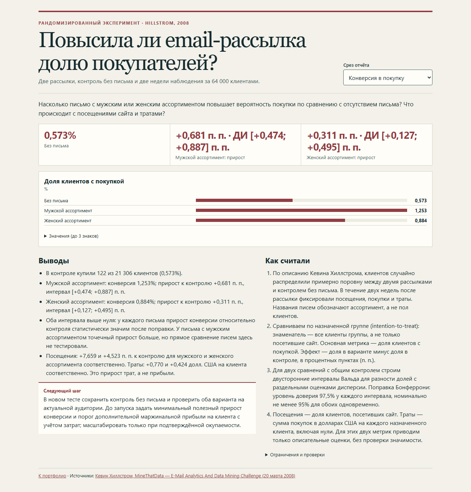

# Повысила ли email-рассылка долю покупателей?

Две рассылки, контроль без письма и две недели наблюдения за 64 000 клиентами.

Насколько письмо с мужским или женским ассортиментом повышает вероятность покупки по сравнению с отсутствием письма? Что происходит с посещениями сайта и тратами?

[Открыть отчёт](dashboard.html) · [Витрина CSV](summary.csv)



## Выводы

- В контроле купили 122 из 21 306 клиентов (0,573%).
- Мужской ассортимент: конверсия 1,253%; прирост к контролю +0,681 п. п., интервал [+0,474; +0,887] п. п.
- Женский ассортимент: конверсия 0,884%; прирост к контролю +0,311 п. п., интервал [+0,127; +0,495] п. п.
- Оба интервала выше нуля: у каждого письма прирост конверсии относительно контроля статистически значим после поправки. У письма с мужским ассортиментом точечный прирост больше, но прямое сравнение писем здесь не тестировали.
- Посещения: +7,659 и +4,523 п. п. к контролю для мужского и женского ассортимента соответственно. Траты: +0,770 и +0,424 долл. США на клиента соответственно. Это прирост трат, а не прибыли.

**Следующий шаг:** В новом тесте сохранить контроль без письма и проверить оба варианта на актуальной аудитории. До запуска задать минимальный полезный прирост конверсии и порог дополнительной маржинальной прибыли на клиента с учётом затрат; масштабировать только при подтверждённой окупаемости.

## Методика

- По описанию Кевина Хиллстрома, клиентов случайно распределили примерно поровну между двумя рассылками и контролем без письма. В течение двух недель после рассылки фиксировали посещения, покупки и траты. Названия писем обозначают ассортимент, а не пол клиентов.
- Сравниваем по назначенной группе (intention-to-treat): знаменатель — все клиенты группы, а не только посетившие сайт. Основная метрика — доля клиентов с покупкой. Эффект — доля в варианте минус доля в контроле, в процентных пунктах (п. п.).
- Для двух сравнений с общим контролем строим двусторонние интервалы Вальда для разности долей с раздельными оценками дисперсии. Поправка Бонферрони: уровень доверия 97,5% у каждого интервала, номинально не менее 95% для обоих одновременно.
- Посещения — доля клиентов, посетивших сайт. Траты — сумма покупок в долларах США на каждого назначенного клиента, включая нули. Для этих двух метрик приводим только описательные оценки, без проверки значимости.

## Ограничения

- Две недели наблюдения в одном историческом эксперименте: результаты нельзя автоматически переносить на другие аудитории, сезоны или частоту рассылок.
- Нет данных о марже, стоимости рассылки и долгосрочных последствиях, включая отписки. Значимый рост доли покупателей не доказывает окупаемость.

## Контроль качества

- SHA-256 исходного CSV совпал с зафиксированным хешем; заголовок соответствует исходной схеме.
- Ровно 64 000 строк в трёх группах: 21 306, 21 307 и 21 387 клиентов.
- Посещение и покупка в каждой строке — бинарные признаки; покупок без посещения нет.
- Все траты конечны и неотрицательны; положительная сумма есть только у купивших, и у каждого купившего она положительна.

## Воспроизводимость

- `analyze.py` — загрузка источника, расчёт и сверки.
- `summary.csv` — агрегаты рассчитанных срезов.
- `case.json` — значения и текст отчёта.

Запустить из этой папки (Python 3.11+, для Excel также `uv`):

```bash
python analyze.py
```

Первый запуск читает открытый источник; исходный кэш не предназначен для репозитория. Из корня портфолио запустите `python assemble.py`, чтобы обновить HTML по рассчитанным `case.json`. PNG — снимок HTML-отчёта.

## Источники

- [Кевин Хиллстром, MineThatData — E-Mail Analytics And Data Mining Challenge (20 марта 2008)](https://blog.minethatdata.com/2008/03/minethatdata-e-mail-analytics-and-data.html)
