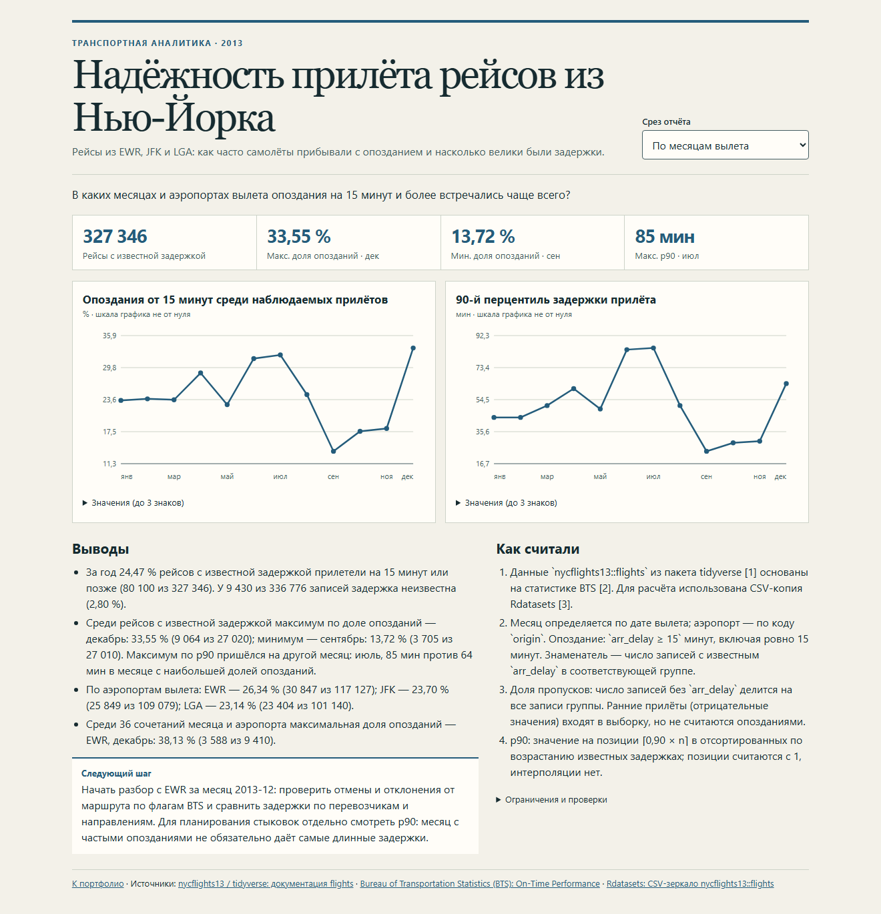

# Надёжность прилёта рейсов из Нью-Йорка

Рейсы из EWR, JFK и LGA: как часто самолёты прибывали с опозданием и насколько велики были задержки.

В каких месяцах и аэропортах вылета опоздания на 15 минут и более встречались чаще всего?

[Открыть отчёт](dashboard.html) · [Витрина CSV](summary.csv)



## Выводы

- За год 24,47 % рейсов с известной задержкой прилетели на 15 минут или позже (80 100 из 327 346). У 9 430 из 336 776 записей задержка неизвестна (2,80 %).
- Среди рейсов с известной задержкой максимум по доле опозданий — декабрь: 33,55 % (9 064 из 27 020); минимум — сентябрь: 13,72 % (3 705 из 27 010). Максимум по p90 пришёлся на другой месяц: июль, 85 мин против 64 мин в месяце с наибольшей долей опозданий.
- По аэропортам вылета: EWR — 26,34 % (30 847 из 117 127); JFK — 23,70 % (25 849 из 109 079); LGA — 23,14 % (23 404 из 101 140).
- Среди 36 сочетаний месяца и аэропорта максимальная доля опозданий — EWR, декабрь: 38,13 % (3 588 из 9 410).

**Следующий шаг:** Начать разбор с EWR за месяц 2013-12: проверить отмены и отклонения от маршрута по флагам BTS и сравнить задержки по перевозчикам и направлениям. Для планирования стыковок отдельно смотреть p90: месяц с частыми опозданиями не обязательно даёт самые длинные задержки.

## Методика

- Данные `nycflights13::flights` из пакета tidyverse [1] основаны на статистике BTS [2]. Для расчёта использована CSV-копия Rdatasets [3].
- Месяц определяется по дате вылета; аэропорт — по коду `origin`. Опоздание: `arr_delay ≥ 15` минут, включая ровно 15 минут. Знаменатель — число записей с известным `arr_delay` в соответствующей группе.
- Доля пропусков: число записей без `arr_delay` делится на все записи группы. Ранние прилёты (отрицательные значения) входят в выборку, но не считаются опозданиями.
- p90: значение на позиции ⌈0,90 × n⌉ в отсортированных по возрастанию известных задержках; позиции считаются с 1, интерполяции нет.

## Ограничения

- В наборе нет отдельного признака отмены. Пропуск `arr_delay` не равен подтверждённой отмене; причины пропусков здесь не установлены.
- Это сравнение за один год без поправок на маршруты, перевозчиков и условия вылета. Оно не позволяет судить о причинах или переносить рейтинг на другие годы.

## Контроль качества

- SHA-256 подтверждает совпадение исходного CSV с использованной версией.
- Контрольный набор проверяет порог 15 минут, отрицательные задержки, пропуски, пустой знаменатель и p90 без интерполяции.
- Найдены все 12 месяцев, 3 аэропорта и 36 сочетаний; суммы по каждому разрезу сходятся с итогом.
- Баланс исходных записей: 327 346 с известной задержкой + 9 430 без неё = 336 776.

## Воспроизводимость

- `analyze.py` — загрузка источника, расчёт и сверки.
- `summary.csv` — агрегаты рассчитанных срезов.
- `case.json` — значения и текст отчёта.

Запустить из этой папки (Python 3.11+, для Excel также `uv`):

```bash
python analyze.py
```

Первый запуск читает открытый источник; исходный кэш не предназначен для репозитория. Из корня портфолио запустите `python assemble.py`, чтобы обновить HTML по рассчитанным `case.json`. PNG — снимок HTML-отчёта.

## Источники

- [nycflights13 / tidyverse: документация flights](https://nycflights13.tidyverse.org/reference/flights.html)
- [Bureau of Transportation Statistics (BTS): On-Time Performance](https://www.transtats.bts.gov/Fields.asp?gnoyr_VQ=FGJ)
- [Rdatasets: CSV-зеркало nycflights13::flights](https://vincentarelbundock.github.io/Rdatasets/csv/nycflights13/flights.csv)
