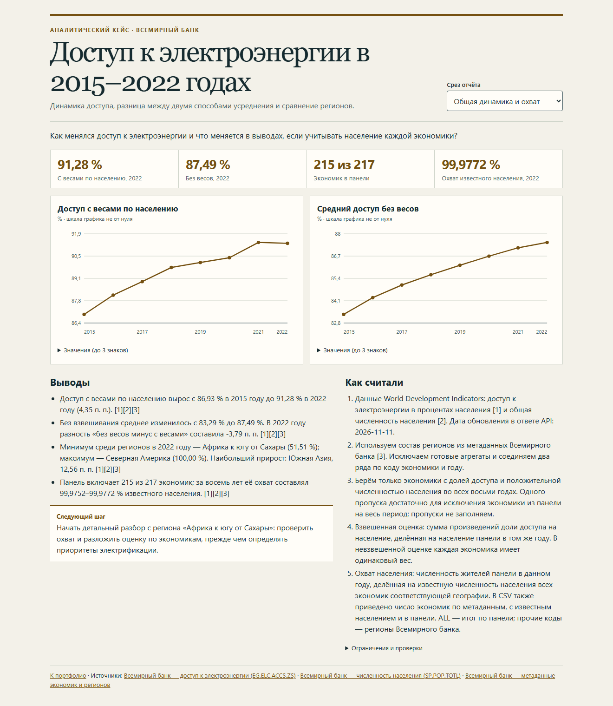

# Доступ к электроэнергии в 2015–2022 годах

Динамика доступа, разница между двумя способами усреднения и сравнение регионов.

Как менялся доступ к электроэнергии и что меняется в выводах, если учитывать население каждой экономики?

[Открыть отчёт](dashboard.html) · [Витрина CSV](summary.csv)



## Выводы

- Доступ с весами по населению вырос с 86,93 % в 2015 году до 91,28 % в 2022 году (4,35 п. п.). [1][2][3]
- Без взвешивания среднее изменилось с 83,29 % до 87,49 %. В 2022 году разность «без весов минус с весами» составила -3,79 п. п. [1][2][3]
- Минимум среди регионов в 2022 году — Африка к югу от Сахары (51,51 %); максимум — Северная Америка (100,00 %). Наибольший прирост: Южная Азия, 12,56 п. п. [1][2][3]
- Панель включает 215 из 217 экономик; за восемь лет её охват составлял 99,9752–99,9772 % известного населения. [1][2][3]

**Следующий шаг:** Начать детальный разбор с региона «Африка к югу от Сахары»: проверить охват и разложить оценку по экономикам, прежде чем определять приоритеты электрификации.

## Методика

- Данные World Development Indicators: доступ к электроэнергии в процентах населения [1] и общая численность населения [2]. Дата обновления в ответе API: 2026-11-11.
- Используем состав регионов из метаданных Всемирного банка [3]. Исключаем готовые агрегаты и соединяем два ряда по коду экономики и году.
- Берём только экономики с долей доступа и положительной численностью населения во всех восьми годах. Одного пропуска достаточно для исключения экономики из панели на весь период; пропуски не заполняем.
- Взвешенная оценка: сумма произведений доли доступа на население, делённая на население панели в том же году. В невзвешенной оценке каждая экономика имеет одинаковый вес.
- Охват населения: численность жителей панели в данном году, делённая на известную численность населения всех экономик соответствующей географии. В CSV также приведено число экономик по метаданным, с известным населением и в панели. ALL — итог по панели; прочие коды — регионы Всемирного банка.

## Ограничения

- Это расчёт по панели, а не готовый мировой агрегат Всемирного банка. Экономики с пропусками могут отличаться по уровню доступа, а население без оценки не входит в знаменатель охвата.
- Население пересчитывается каждый год: взвешенная динамика отражает и изменения доступа, и изменения относительной численности населения. Показатель не измеряет надёжность или стоимость электроснабжения.
- Всемирный банк может пересматривать исторические ряды. Повторная загрузка воспроизводит метод, а запуск из сохранённого снимка — исходные значения.

## Контроль качества

- Проверены уникальность и полнота сводки: 64 строк, 8 лет и 8 географических срезов.
- По пересечению исходных рядов подтверждена постоянная панель: 215 из 217 экономик, без агрегатов API.
- Для каждой строки независимо пересчитаны обе суммы населения и доля покрытия.
- Взвешенная и невзвешенная оценки независимо пересчитаны и совпали с SQL во всех строках.

## Воспроизводимость

- `analyze.py` — загрузка источника, расчёт и сверки.
- `summary.csv` — агрегаты рассчитанных срезов.
- `case.json` — значения и текст отчёта.
- `analysis.sql` — SQL-логика формирования аналитических срезов.

Запустить из этой папки (Python 3.11+, для Excel также `uv`):

```bash
python analyze.py
```

Первый запуск читает открытый источник; исходный кэш не предназначен для репозитория. Из корня портфолио запустите `python assemble.py`, чтобы обновить HTML по рассчитанным `case.json`. PNG — снимок HTML-отчёта.

## Источники

- [Всемирный банк — доступ к электроэнергии (EG.ELC.ACCS.ZS)](https://data.worldbank.org/indicator/EG.ELC.ACCS.ZS)
- [Всемирный банк — численность населения (SP.POP.TOTL)](https://data.worldbank.org/indicator/SP.POP.TOTL)
- [Всемирный банк — метаданные экономик и регионов](https://api.worldbank.org/v2/country?format=json&per_page=400)
