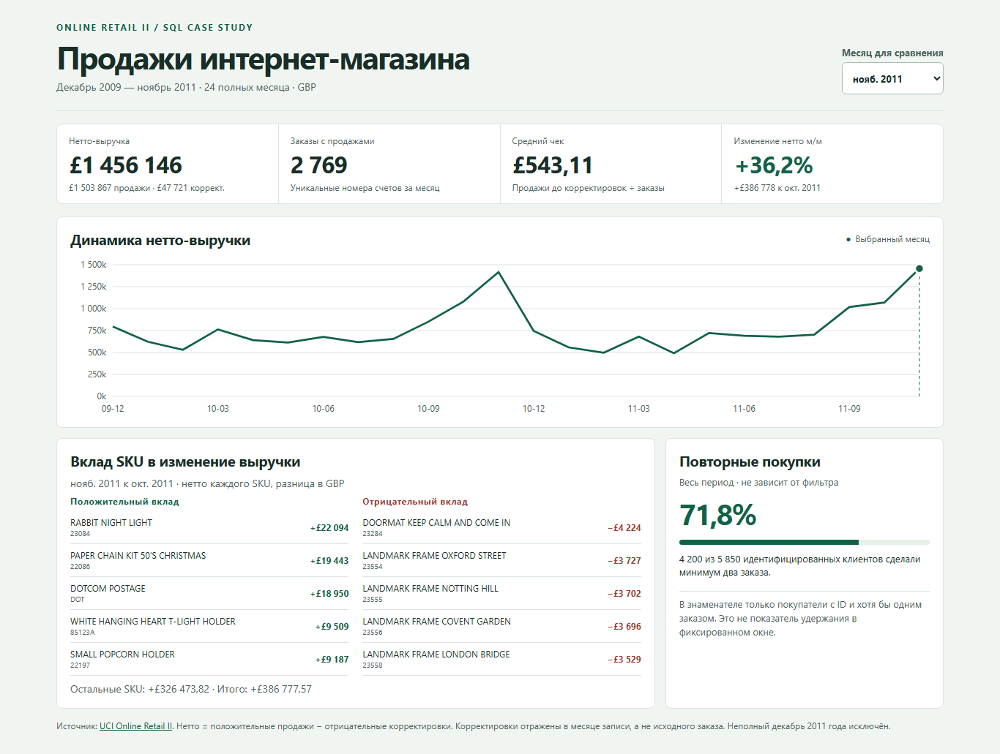

# Online Retail II — продажи и повторные покупки

[Открыть локальный дашборд →](dashboard.html) · [SQL](sql/analysis.sql) · [Power BI](powerbi/README.md)



## Откуда взялся рост в ноябре 2011 года?

В ноябре 2011 года нетто-выручка достигла **£1,456,145.80** — максимум из 24 полных месяцев, **+36.2% к октябрю**. Рост на **£386,777.57** распределён по множеству позиций: крупнейший вклад у `23084` (Rabbit Night Light) — **+£22,094.06**, около 5.7% прироста. `22086` (Paper Chain Kit 50's Christmas) добавил **£19,443.00**. Среди лидеров также оказался `DOT` (Dotcom Postage, **+£18,950.27**): это код доставки, а не товар. Для закупок стоит смотреть на товарные SKU отдельно от сборов.

- **За 24 месяца:** £19.84 млн продаж до корректировок, £1.26 млн отрицательных корректировок, **£18.58 млн нетто** и **39 258** счетов с продажами.
- **Повторные покупки:** **4 200 из 5 850** клиентов с ID и хотя бы одной покупкой оформили два и более разных заказа (**71.8%**). Это доля за весь период наблюдения, а не 30-дневное удержание. На строки продаж без ID приходится **15.0%** продаж до корректировок; эти суммы остаются в финансовых метриках.
- **Что проверить дальше:** перед планированием запасов сравнить товарные SKU и доставку отдельно, затем разложить рост на количество единиц и цену. Для CRM — построить 30/60/90-дневные когорты по первой наблюдаемой покупке и исключить когорты с неполным окном наблюдения. Данные не показывают, что рост вызвала конкретная акция.

## Источник и расчёт

Online Retail II содержит реальные записи британского интернет-магазина с 1 декабря 2009 по 9 декабря 2011 года; в источнике есть пропуски, а префикс `C` в номере счёта означает отмену.[1] Отчёт использует 24 полных календарных месяца: декабрь 2009 — ноябрь 2011. По одному только этому датасету нельзя проверить полноту загрузки внутри каждого месяца.

1. **Импорт:** Python читает оба листа XLSX и загружает **1 067 371** строку в SQLite. Нормализуются пробелы, регистр кодов и типы. Цены хранятся целыми числами в единицах 1/100 000 GBP.
2. **Разметка:** продажа — положительные количество и цена, номер без `C`. Любая строка с отрицательным количеством и положительной ценой — отрицательная корректировка, независимо от префикса. Без ссылки на исходный заказ нельзя надёжно восстановить пару продажа–возврат, поэтому корректировка отражается в месяце записи. Положительная строка с `C` исключена как противоречивая. Нулевые количества и цены ≤ 0 тоже исключены; это выбранная аналитическая политика, не утверждение о качестве каждой записи.
3. **Сверка строк:** 6 208 исключены по правилам разметки, 34 147 удалены как полные совпадения нормализованных полей, 25 193 уникальные пригодные строки вне окна анализа. Осталось **1 001 823** строки. Полное совпадение полей — предположение о дубле: без идентификатора строки счёта нельзя доказать, что все исключённые строки ошибочны. Если оставить полные совпадения, нетто за тот же период вырастает на £430,749.92 (+2.32% к основному расчёту). Сводку до очистки см. в `powerbi/Quality.csv`.
4. **Продажи, нетто и чек:** продажа = количество × цена; нетто = продажи − абсолютная сумма корректировок. Заказы = уникальные номера счетов, на которых есть продажа. Средний чек = продажи до корректировок ÷ заказы. Это транзакционные показатели, не прибыль и не бухгалтерская выручка.
5. **Вклад SKU:** нетто SKU за выбранный месяц минус его нетто в предыдущем месяце. Если в одном из месяцев SKU отсутствует, берётся ноль. Сумма вкладов всех кодов равна изменению нетто магазина. В кодах встречаются сборы и служебные записи; карточка намеренно показывает вклад **всех** кодов для сверки. Название берётся по самому частому варианту среди строк продаж данного SKU.
6. **Повторные покупки:** на каждого клиента с ID считается число уникальных счетов с продажами за весь период. Клиент считается повторным при двух и более счетах. Клиенты, купившие ближе к концу периода, имели меньше времени, чтобы вернуться. Сумма уникальных клиентов по месяцам не равна уникальным клиентам за период.

## Запуск

Для просмотра скачайте или распакуйте проект и откройте `dashboard.html` браузером. Данные встроены, соединение с интернетом не нужно. GitHub может показать PNG, но для интерактивного просмотра скачайте HTML.

Для пересборки с `uv` (Python 3.11+):

```bash
uv run --with-requirements requirements.txt python build.py
uv run --with-requirements requirements.txt python -m unittest discover -s tests -v
```

Первый запуск требует интернет для получения исходного архива UCI (около 44 МБ) и зависимости `openpyxl`.[1] Если архив уже скачан, передайте `--archive путь-к-архиву.zip`. Контрольная сумма SHA-256 проверяется перед импортом. Локальная база для ручной проверки запросов находится в `.cache/retail.sqlite`; она не включена в ZIP. `dashboard.png` — снимок отчёта, а не выход SQL-сборки.

| Файл | Что смотреть |
|---|---|
| `sql/analysis.sql` | `GROUP BY`, оконные функции, `JOIN`, витрины продаж, вкладов и клиентов |
| `results.json` | Проверенные метрики и журнал очистки, встроенные в HTML |
| `powerbi/*.csv`, `powerbi/Measures.dax` | Витрины и меры для сборки в Power BI Desktop; готового `.pbix` нет |
| `tests/test_project.py` | Правила обработки на контрольных строках, сверка CSV и всех месячных вкладов |

Данные адаптированы из Online Retail II (CC BY 4.0).[1]

## Источник данных

[1] https://archive.ics.uci.edu/dataset/502/online%2Bretail%2Bii — Chen, D. (2012). Online Retail II. UCI Machine Learning Repository.
